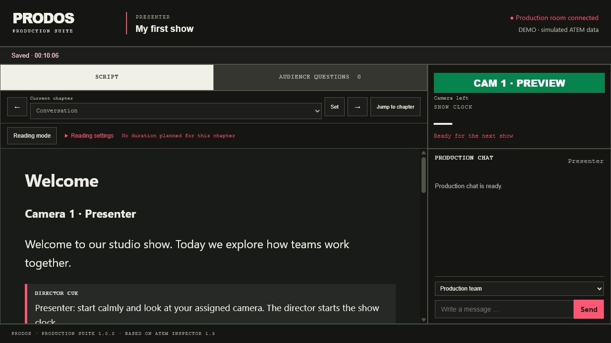

# PRODOS 1.0.0

An English production communication suite for a Windows director PC, browser-based editorial and presenter workspaces, and eight phone camera tallies. Built on ATEM Inspector 1.3. Version 1.0.0 preserves the feature set of release 0.3.2; this is a public branding and localization release, not a new ATEM compatibility implementation.

## Start with the Windows package

1. Download the Windows x64 release ZIP and extract **all** files.
2. Install Node.js (20 or newer; Node 24 was used for release testing). Install Cloudflare `cloudflared` if phones need internet access. `00_INSTALL_PREREQUISITES.cmd` helps install prerequisites using Windows Package Manager. Corporate PCs may require IT approval.
3. Run `03_START_DEMO.cmd` to try the native Windows demo. Click **Production Suite** to open the director workspace in your browser.
4. Run `02_START_PRODOS.cmd` for a physical ATEM. Enter its IPv4 address and click **Connect**.
5. Start Cloudflare in **Connections, QR codes & cameras** and share individual role QR codes with the crew. Phones can use mobile data; they do not need the ATEM LAN.

The Windows package includes a self-contained .NET executable and Node dependencies. Node.js and cloudflared are separate installations. The executable is unsigned. Do not launch it from inside the ZIP.

## Build from this repository

Requirements: Windows x64, Node.js with npm, .NET 8 SDK. Cloudflare is optional for local demos.

Run `01_SETUP_AND_BUILD.cmd`. It restores locked dependencies, runs Node tests, builds the Windows application, and copies the bridge into `publish`. Then run `02_START_PRODOS.cmd` or `03_START_DEMO.cmd`.

PowerShell alternative: `powershell -ExecutionPolicy Bypass -File .\04_BUILD.ps1`. Use `-FrameworkDependent` only if a suitable .NET desktop runtime is installed.

For the browser demo alone, run `05_BROWSER_DEMO.cmd`. Keep its terminal open. Stop it with Ctrl+C. Run `06_RUN_TESTS.cmd` for Node tests and `powershell -ExecutionPolicy Bypass -File .\07_TEST_INSPECTOR.ps1` for the Windows integration test after installing dependencies.

## Included workflow

- One active show; create, load, duplicate, rename, export and import multiple saved shows.
- Planned and actual start/end times, chapter timing, event history and persistent messages.
- Safe Markdown script rendering, independent scrolling, reading settings and chapter arrows for director, editorial and presenter roles.
- Manual audience question entry by editorial staff from an external platform. Exactly two states: active and done. Done questions are grey at the bottom and can be reactivated. No public audience form or automatic integration.
- Role assignments, presenter camera selection, required team roles, presence and preflight checks.
- Chat with **Understood**, one check for at least one acknowledging recipient and two for all intended recipients. Checks indicate explicit acknowledgement, not passive viewing.
- Director push messages: blue `#0053FF`, white text, three seconds across editorial, presenter and camera pages. Camera-only one-second red flash when switching to LIVE.
- Individual secret role links and QR codes through a Cloudflare Quick Tunnel.

The only example script is [Studio show](examples/Studio-show.md); new shows use this same neutral English sample. No personal show database, role credentials, chat history or original development archive is distributed.

## Compatibility and limits

The implementation targets ATEM Mini Extreme ISO via Ethernet and `atem-connection` 3.10.2. It has **eight fixed camera slots and uses M/E 1**. It does not detect or hide unavailable inputs. With a four-input ATEM, slots 5–8 remain visible and may show READY/OFF; do not assign or share those slots. No hardware model is certified by the demo or automated tests.

Support by the underlying library is not proof that PRODOS supports every ATEM feature or model. USB control, automatic input counts, more than eight camera tallies and additional M/E buses are not supported. See [compatibility](docs/COMPATIBILITY.md).

Cloudflare Quick Tunnels are intended for testing, provide no availability guarantee and issue temporary URLs. This release is not a high-availability broadcast control system. See [security and deployment](SECURITY.md).

## Data and documentation

Live and demo data are separate in `%LOCALAPPDATA%\PRODOS`: `production.json` and `demo-production.json`. `PRODOS_DATA_PATH` overrides the data file. Close the app before copying a complete data directory. Exports deliberately omit role tokens; imports generate new tokens and IDs. User-authored content is preserved in its original language.

- [Operator guide](docs/OPERATOR-GUIDE.md)
- [Architecture and protocol](docs/ARCHITECTURE.md)
- [Tests and release validation](docs/TESTING.md)
- [GitHub upload guide](docs/GITHUB.md)
- [Third-party notices](THIRD_PARTY_NOTICES.md)
- [Release notes](CHANGELOG.md)

## License

Project-owned code is licensed under the [MIT License](LICENSE). Third-party components retain their own licenses. PRODOS is independent and is not affiliated with or endorsed by Blackmagic Design, Cloudflare or Apple.
